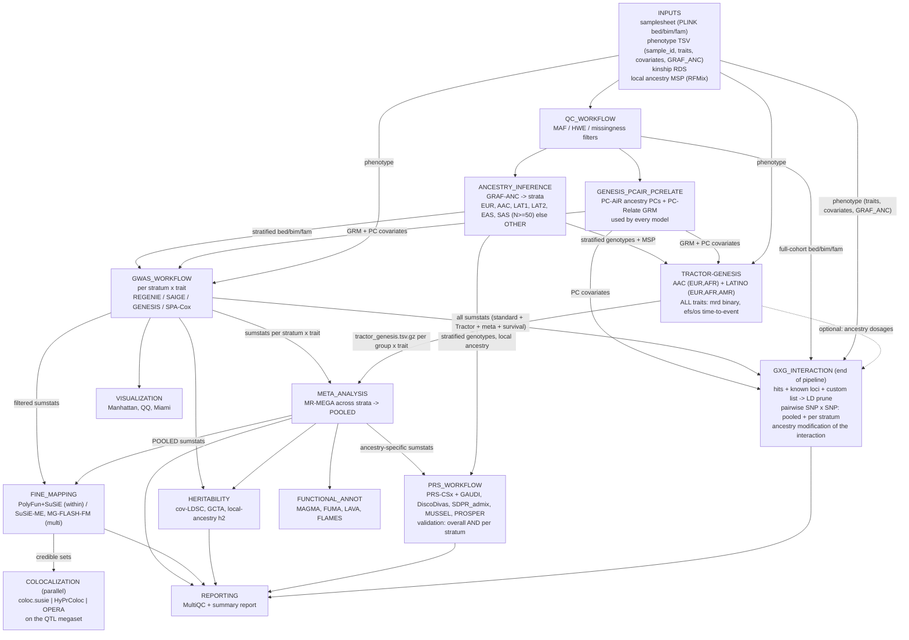
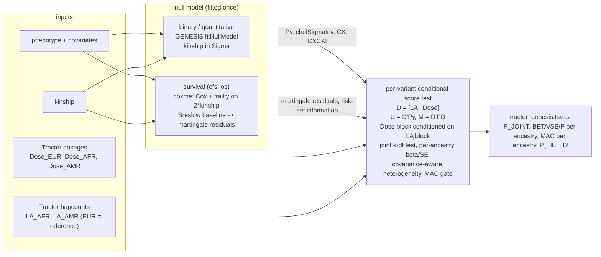
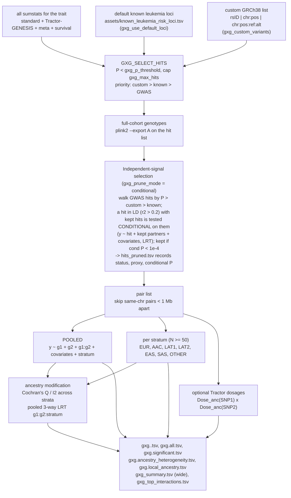
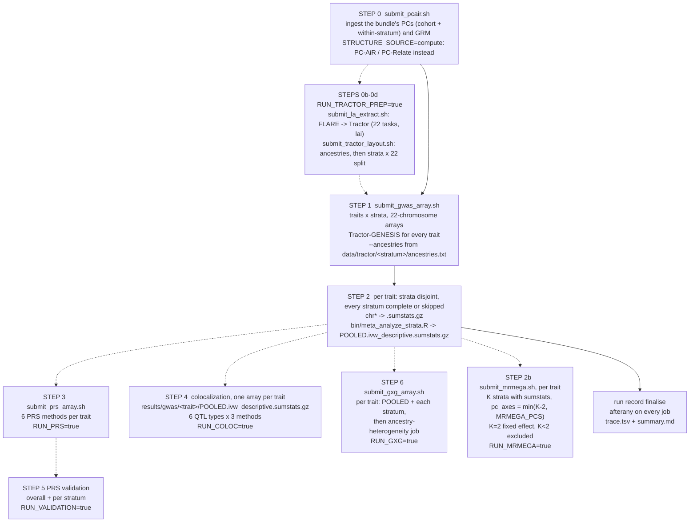

# Pipeline workflow: what happens to the data, module by module

This is the current data flow for the multi-ancestry leukemia GWAS pipeline.
Boxes are Nextflow subworkflows or processes; every arrow is a file handed from
one module to the next. The same steps exist as SLURM array scripts under
`slurm/` (section 6), which call the same `bin/` scripts.

## 0. Inputs: what the pipeline expects at the start

| Input | Param | Format | Notes |
|---|---|---|---|
| Samplesheet | `input` | CSV, header. Required column `sample_id` (one row per genotype set, e.g. per cohort), plus ONE of: `bed,bim,fam` / `pgen,pvar,psam` / `bgen,sample[,bgi]` / `vcf[,vcf_index]`; optional `cohort` | Validated by `bin/check_samplesheet.py`; non-PLINK1 sets are converted to bed/bim/fam in QC |
| Phenotype file | `phenotype_file` | TSV, header. **`FID` and `IID` must be the first two columns** (REGENIE, SAIGE, SPA-Cox require it; the R scripts accept `IID` or `sample_id`). `IID` must match the genotype sample IDs | Nothing is inferred from the file |
| Traits | `phenotype_cols` | comma list of column names | **Traits are exactly these columns.** `binary_traits` (0/1) and `survival_traits` (needs `<trait>_time`, `<trait>_event`) pick the model; anything else is quantitative |
| Covariates | `covariate_cols` | comma list of column names | **Covariates are exactly these columns.** List `PC1..PCn` here; with `run_pcair = true` they are replaced by PC-AiR PCs before any model runs |
| Ancestry labels | `gxg_ancestry_col` (default `GRAF_ANC`) | a column of the phenotype file | GRAF-ANC codes or labels; used by GxG and PRS validation to stratify |
| Ancestry calls | `ancestry_calls_file` (when `run_ancestry_inference = false`) | TSV/CSV: `sample_id`, `ancestry` (codes or labels) | Normalised by `ANCESTRY_CALLS_PREPARE`; defines the per-ancestry strata (N ≥ `min_ancestry_n`) |
| Local ancestry | `local_ancestry_files` | glob of RFMix `.msp.tsv` files | Required for Tractor (`run_tractor`); RFMix / G-Nomix are not bundled |
| Kinship / GRM | none needed | produced by `GENESIS_PCAIR_PCRELATE` | `kinship_matrix` is only read when `run_pcair = false` |
| LD reference | `ld_reference_dir` | directory with `<ancestry>.bed/bim/fam` (cohort-specific from `calculate_cohort_ld.R`, or a panel) | SuSiE-RSS, PRS, coloc |
| QTL datasets | `custom_qtl_datasets` / `eqtl_datasets` | CSV: `name,type,path[,ancestry,tissue]` | plus the curated megaset via `download_qtl_datasets.R` |

Example phenotype file:

```
FID   IID   sample_id   mrd   efs_time  efs_event  os_time  os_event  protocol  sex  age_at_diagnosis  cd19_pos_pct  storage_days  PC1 ... PC5
```
with `phenotype_cols = 'mrd,efs,os'`, `survival_traits = 'efs,os'`, `binary_traits = 'mrd'`,
`covariate_cols = 'sex,age_at_diagnosis,cd19_pos_pct,storage_days,PC1,PC2,PC3,PC4,PC5'` (the bundle's `phenotypes/covariates.txt`, then five PCs).

## 1. End-to-end overview



## 2. Module inputs and outputs

| Module (subworkflow / process) | Reads | Writes | Feeds |
|---|---|---|---|
| `INPUT_CHECK` | samplesheet CSV | validated genotype channel | QC |
| `QC_WORKFLOW` | bed/bim/fam | QC'd bed/bim/fam, QC report | ANCESTRY, PC-AiR, GxG (full cohort) |
| `GENESIS_PCAIR_PCRELATE` (`bin/genesis_pcair_pcrelate.R`) | QC'd full cohort, phenotype | PC-AiR PCs (`.pcair.pcs.tsv`), PC-Relate GRM (`.pcrelate.grm.rds`), kinship, unrelated set, phenotype with PC1..PCn replaced | GWAS null models, Tractor-GENESIS, GxG, PRS validation (every model uses the same GRM and PCs) |
| `ANCESTRY_INFERENCE` | QC'd genotypes, GRAF reference, MSP | `ancestry_calls.tsv`, stratified bed/bim/fam per group, local ancestry channel | GWAS, Tractor, PRS |
| `GWAS_WORKFLOW` (standard) | stratified genotypes x trait, phenotype, covariates, kinship | `<id>.<ancestry>.<trait>.sumstats.gz`, filtered sumstats, significant variants | META, FM, H2, VIS, GxG |
| `PLINK_TO_VCF` -> `TRACTOR_EXTRACT_TRACTS` | AAC and merged LATINO genotypes + MSP; `meta.tractor_pops` | `<id>.ancdose.<k>.tsv.gz`, `<id>.hapcount.<k>.tsv.gz` per ancestry k | TRACTOR_GENESIS |
| `TRACTOR_GENESIS` (`bin/tractor_genesis_adapter.R`) | dosages + hapcounts, phenotype, kinship, covariates; `meta.model` | `<prefix>.tractor_genesis.tsv.gz` (sorted by P_JOINT), `.genomic_order.tsv.gz`, `.top_hits.tsv`, `.significant.tsv`, `.heterogeneous.tsv`, `.<anc>_specific.tsv`, `.null_model.rds` | META, GxG |
| `META_ANALYSIS` | sumstats grouped by trait across strata | MR-MEGA results, heterogeneity table; SLURM path: `bin/meta_analyze_strata.R` -> `POOLED.ivw_descriptive.sumstats.gz` | FM, H2, PRS, FUNC, GxG |
| `FINE_MAPPING` | filtered sumstats, LD reference / cohort LD | credible sets, PIPs | COLOC |
| `COLOCALIZATION` (`COLOC_RUN` = `bin/run_colocalization.R`) | every ancestry-stratified GWAS (standard + Tractor-GENESIS) and the meta/POOLED GWAS; QTL megaset pooled by type (`curated_qtl_sources.yml` via `download_qtl_datasets.R`, `harmonize_qtl.R`); optional cohort LD | per GWAS: `.coloc_susie.tsv`, `.hyprcoloc.tsv`, `.opera.tsv`; per trait: `coloc_combined.tsv`, `coloc_consensus.tsv`, shared / divergent / meta-only tables, PP4 heatmap | REP |
| `HERITABILITY` | sumstats, meta results, LD reference | h2 per stratum, local-ancestry h2, genetic correlations | REP |
| `PRS_WORKFLOW` (`PRS_METHOD` = `bin/calculate_prs_admixed.R`) | ancestry-specific sumstats per trait, LD reference, full-cohort genotypes, local ancestry, phenotype with PC-AiR PCs | per method: weights and `.sscore`; `<trait>.la_partial.scores.tsv` (Tractor dosages x Tractor-GENESIS betas: the part of each score on EUR / AFR / AMR haplotypes); `<trait>.validation.tsv` (OVERALL + one row per stratum, AUC / R2 / C-index); `prs_comparison.tsv`, `best_prs.tsv` (best overall and per stratum, disparity flags) | REP |
| `FUNCTIONAL_ANNOT` | meta or filtered sumstats | MAGMA / FUMA / LAVA / FLAMES outputs | REP |
| `GXG_INTERACTION` (`bin/run_gxg_interaction.R`) | see section 4 | see section 4 | REP |
| `REPORTING` | everything above | HTML report | user |

## 3. Tractor-GENESIS: one engine for every trait

Every trait goes through the same conditional score test so mrd, efs and os
are comparable. The trait's `model` (set in `main.nf` from `binary_traits` and
`survival_traits`) only changes where the projection comes from.



A stratum with one ancestry (k = 1; its `ancestries.txt` has one line, e.g. EUR) needs only the
dose file (the hard-call dosage): no hapcount file is read, every sample carries two haplotypes of
that ancestry, there is no local-ancestry term, and the test is the standard 1-df score test, so
`P_JOINT` is identical to `P_<anc>` (B-01). The GRM stays in the null model as for every stratum.

Samples (CP-17): the adapter analyses the phenotype rows that are in the Tractor files, in the
stratum's `results/strata/<S>.samples.txt` (`--sample_include`), in the GRM (a joined sample missing
from it stops the run: `sample X missing from GRM`), and complete on the outcome and every
covariate. Rows dropped for a missing value are counted and reported before the null model is
fitted. The **MAC gate** counts the **minor** allele: a variant is tested only if its stratum-wide
minor allele count, `MAC_STRATUM = min(ALT, 2n - ALT)`, reaches `MAC_MIN`, and an ancestry's dose
term only if that background's minor count, `MAC_<anc> = min(ALT_anc, haplotypes_anc - ALT_anc)`,
does (an allele at ALT frequency 0.94 on a background has a small minor count). `MAC_MIN` stays 10
until decided (the contract says 20). `STRATUM` is the first column of every table. The Tractor files are streamed (M-02, `--read_mode stream`, the default): `--chunk_size` variants are
read from every hapcount and dose file in lockstep (a file out of step stops the run, naming it and
the first variant that differs), so memory grows with chunk x samples, not variants x samples;
`--read_mode full` reads them whole first and gives identical results. The adapter prints its peak
memory at the end. Variants are tested in chunks of `--chunk_size` by `--threads` forked
workers (the GWAS array passes `SLURM_CPUS_PER_TASK`; the results do not depend on it). The null
model is fitted once per stratum x trait and cached in `results/gwas/<trait>/<S>/null_model.rds`
(`--null_model_rds`): the other chromosome tasks log `null loaded`, and a cache fitted on other
samples, covariates or GRM is refitted. A Cox null with a GRM needs coxme: without it the run stops
(`coxme required`) unless `--allow_unrelated_cox`. The score test
itself is in `bin/tractor_model.R`; `tests/test_tractor_model.R` checks it against `survival::coxph`
(the Cox score statistic agrees to 1e-6, with and without covariates). The survival path needs no
GENESIS, which is loaded only for the binary / quantitative null.

Every covariate must be a numeric phenotype column: the adapter stops, naming the column
(`covariate PCX not found in ...`, `covariate sex is not numeric ...`), before it reads a Tractor
file or fits anything. Each results table starts with `## covariates=<the list used>` (global
ancestry columns included), then its column header. `fread` skips such `## key=value` lines by
itself; the combine step keeps them once (and stops if two chromosomes disagree);
`meta_analyze_strata.R` writes one `## covariates=` line when the strata agree, one
`## covariates_<stratum>=` line each when they do not (`bin/sumstats_io.R`).

The QQ and Manhattan plots and the hit filter (`bin/create_qq_plot.R`, `bin/create_manhattan_plot.R`,
`bin/filter_gwas_results.py`) take `--p-col` (e.g. `--p-col P_EUR`); without it they use `P_JOINT`,
then `P` / `PVALUE` / `P_VALUE`. The lambda GC shown is always that of the plotted column, written to
`<prefix>.lambda.txt` by the QQ script; a `--lambda-gc` file is printed for comparison, never used.
The filter also writes a locus table (`--loci`, default `<prefix>.loci.tsv`): **distance-based, not
LD-based**. Per stratum, the suggestive variant with the lowest P is an index variant and every
unassigned suggestive variant within `--window-kb` (default 500) of it on its chromosome joins its
locus; repeat. The table's `##` lines state the method, window, P column and threshold; the variant
list gains `LOCUS`, `LOCUS_INDEX` and `IS_INDEX`.

## 4. GxG interaction (end of pipeline)



Models: logistic for binary traits, linear for quantitative, Cox for survival.
Each pair reports Wald and LRT p-values with Bonferroni over pairs and BH FDR.

## 5. Traits, covariates, strata: what is customisable

| Setting | Nextflow | SLURM | Notes |
|---|---|---|---|
| Traits | `phenotype_cols` | `TRAITS_LIST` (default `mrd,efs,os`) | phenotype columns; the launcher refuses a trait whose column(s) the phenotype file lacks |
| Binary traits | `binary_traits` | everything not in `SURVIVAL_TRAITS` | 0/1 |
| Time-to-event traits | `survival_traits` (+ `survival_time_cols`, `survival_event_cols`) | `SURVIVAL_TRAITS` (default `efs,os`); `TIME_COL_<trait>`, `EVENT_COL_<trait>` override one trait | columns `<trait>_time`, `<trait>_event`, as the handoff contract names them; each trait has its own |
| PC scale | (none) | `PC_SCALE` (`stratum` default, or `cohort`) | which PCs a stratum's GWAS adjusts for; POOLED always uses the cohort PCs |
| MIX stratum | (none) | `MIX_RETAIN` (`true` default, or `false`) | `false` leaves the bundle's MIX stratum out of the default strata |
| Run label | (none) | `RUN_LABEL` (empty default) | a sensitivity arm's results go under `results/<RUN_LABEL>/` |
| Covariates | `covariate_cols`, `gxg_covariates` | `COVARIATES` (default: the bundle's `phenotypes/covariates.txt`, then `PC1..PC5`) | numeric phenotype columns: the launcher refuses a name that is not a column, the adapter one that is not numeric; the list used is written as `## covariates=` above every results table |
| Ancestry column | `gxg_ancestry_col` | `ANCESTRY_COL` | GRAF-ANC codes or labels |
| Strata rules | `min_stratum_n`, `bin/ancestry_config.R` | `STRATA_LIST` (default: every stratum of the bundle's `ancestry/strata.tsv`; a name it lacks is refused), `MIN_STRATUM_N`, `bin/ancestry_config.R` | `MIN_STRATUM_N` default 50 (decided 10 Nov 2026); a smaller stratum is skipped, and STEP 2 names it in the pooled file's `## strata_skipped=` |
| Known loci | `gxg_known_loci`, `gxg_use_default_loci` | `KNOWN_LOCI`, `GXG_USE_DEFAULT_LOCI` | default table is a starting point; verify positions |
| Custom variants | `gxg_custom_variants` | `GXG_CUSTOM_VARIANTS` | GRCh38, one per line |
| Steps run | (no switch) | `RUN_PRS`, `RUN_COLOC`, `RUN_VALIDATION`, `RUN_GXG` (default `false`) | every SLURM launch prints the steps it deferred |
| Hit selection among LD-correlated hits | `gxg_prune_mode`, `gxg_cond_p_threshold`, `gxg_max_pair_r2`, `gxg_min_distance_kb` | `GXG_PRUNE_MODE`, `GXG_COND_P` | conditional (default): LD-correlated hit tested conditional on kept hits, kept if cond P < 1e-4; precedence GWAS > custom > known |
| Tractor | `tractor_aac_pops`, `tractor_lat_pops`, `tractor_ref_ancestry`, `tractor_mac_min` | `data/tractor/<stratum>/ancestries.txt`, one per stratum, read by `submit_gwas_array.sh`; `MAC_MIN` | no default list: a stratum without the file is refused. `MAC_MIN` default 10; open question: the handoff contract says 20 |

## 6. SLURM orchestration (`slurm/submit_full_pipeline.sh`)



Dashed steps are off by default and run only with their `RUN_*` variable set to `true`; every
launch prints the ones it deferred. Steps 0b-0d (CP-16, `RUN_TRACTOR_PREP=true`) make the Tractor
files from the bundle's FLARE output instead of expecting `data/tractor/<S>/` to be prepared: 0b
runs Tractor's `extract_tracts_flare.py` per chromosome (`bin/la_flare_to_tractor.sh`: labels from
the index map, checked against the FLARE VCF's own `##ANCESTRY` line; every ancestry needs a
hapcount and a dosage file; hapcounts sum to 2) into `data/tractor/cohort/`; 0c writes each
stratum's `ancestries.txt` (the ancestries carrying at least `LA_MIN_SHARE`, default 0.01, of its
haplotypes; a curated file already there is kept); 0d splits each stratum x chromosome by
`results/strata/<S>.samples.txt`, folding an ancestry left out into EUR, and gives a one-ancestry
stratum a single `chr<N>.ancdose.<anc>.tsv.gz` (the summed hard-call dose) and no hapcount file. STEP 2b (MR-MEGA, CP-20) counts K, the strata whose
`<stratum>.sumstats.gz` exists, and uses `pc_axes = min(K-2, MRMEGA_PCS)` (default 3): K = 2 is a
fixed-effect meta-analysis, not MR-MEGA, and says so in its output header; K < 2 excludes the
trait, and the log says why. `DRY_RUN=1 bash slurm/submit_mrmega.sh <trait>` prints the decision.
Its per-stratum input (one effect per variant: `BETA_TOTAL` / `SE_TOTAL`, the total-dose test) comes
from `bin/sumstats_to_mrmega.py` (CP-19), which checks EA = ALT / NEA = REF against the bundle's
`.bim`; results go to `results/mrmega/<trait>/` (`docs/SUMSTATS_SCHEMA.md`). The launcher needs `SLURM_PARTITION` and `SLURM_ACCOUNT` in
the environment and puts them on every sbatch line, with absolute log paths under `LOG_DIR`
(default `<repo>/logs`). Every job activates its conda env first (`source bin/activate_env.sh
gwas-r`, which also puts `TMPDIR` on disk) and writes its row of the run record,
`results/run_record/<run_id>/` (section 9). Site settings: `docs/HPC_SITE.md`; setup and check
steps: the combined runbook (the harmonization repo's `genotyping_pipeline/benchmarking/SMOKE_RUNBOOK.md`,
part "GWAS pipeline").

Results land under `results/gwas/<trait>/<stratum>/`, `results/prs/<trait>/`,
`results/coloc/<trait>/`, `results/gxg/<trait>/`.

## 7. Dual structure: both paths call the same scripts

Every analysis step now has one implementation in `bin/` that both the
Nextflow modules and the SLURM scripts call:

| Step | Script | Nextflow process | SLURM |
|---|---|---|---|
| Structure: ingest the bundle's PCs and GRM | `ingest_structure.R` | (none) | `submit_pcair.sh` (step 0, default) |
| PC-AiR + PC-Relate (comparator) | `genesis_pcair_pcrelate.R` | `GENESIS_PCAIR_PCRELATE` | `submit_pcair.sh` with `STRUCTURE_SOURCE=compute` |
| Tractor-GENESIS GWAS | `tractor_genesis_adapter.R` | `TRACTOR_GENESIS` | `submit_gwas_array.sh` |
| Strata meta-analysis | `meta_analyze_strata.R` | (MR-MEGA in Nextflow) | step 2 |
| PRS (6 methods, LA partial, stratified validation) | `calculate_prs_admixed.R` | `PRS_METHOD`, `PRS_LA_PARTIAL`, `PRS_VALIDATE_STRATIFIED` | `submit_prs_array.sh` |
| Colocalization (coloc.susie, HyPrColoc, OPERA) | `run_colocalization.R` | `COLOC_RUN`, `COLOC_COMBINE` | step 4 |
| GxG interaction | `run_gxg_interaction.R` | `GXG_*` | `submit_gxg_array.sh` |
| QC verdicts and sample accounting (sourced) | `qc_assert.R` | inside the scripts above (no gates) | inside the scripts above; gates via `qc_gate.sh` (section 10) |

The wrappers under `shell/` call the same `bin/` scripts but are debug-only, not the execution
path: they do not pass `--stratum`, `--mac_min` or `--chromosome`, activate no env and write no
run record (`shell/README.md`).

The older single-method modules (`prs_csx`, `prs_cs`, `gaudi`, `ldpred2`,
`coloc`, `ecaviar`, `fastenloc`) remain in `modules/local/` but are no longer
wired into the workflow.

## 8. What comes out per ancestry

Tractor-GENESIS reports, for every variant and trait: `P_JOINT` (any effect),
and for each ancestral background `BETA_<anc>`, `SE_<anc>`, `Z_<anc>`,
`P_<anc>`, `MAC_<anc>`, plus `P_HET` and `I2` for whether the effects differ
across backgrounds. The per-stratum SLURM runs add stratum-level results
(one per stratum of the bundle's `strata.tsv`) on top, and `meta_analyze_strata.R` pools each
background across strata.

STEP 2 (one job per trait) first checks the strata: no sample in two
`results/strata/<S>.samples.txt` (else `strata not disjoint`), and every stratum either has all 22
chromosomes' results or was skipped below `MIN_STRATUM_N` on every chromosome (each task's
`run_counts.tsv` says which); anything else stops the job naming the stratum. It then combines
the chromosomes and pools the analysed strata into `POOLED.ivw_descriptive.sumstats.gz` (a
descriptive IVW / random-effects summary), whose `##` lines name the strata pooled, the strata
skipped and the backgrounds. With fewer than two analysed strata no pooled file is written. PRS adds the local-ancestry partial scores, and
GxG reports every interaction pooled, per stratum, and for ancestry
modification.

## 9. Run record (SLURM)

Every launch of `slurm/submit_full_pipeline.sh` writes `results/run_record/<run_id>/`
(`results/` is not committed):

| file | written by | content |
|---|---|---|
| `params.tsv` | the launcher, before any job | every number-changing switch: `param`, `value`, `set_by` (`environment`, `default`, or `job` for a file the job picks at run time) |
| `run_info.tsv` | the launcher | run id, git commit, uncommitted changes yes/no, launch time and host, partition, account, deferred steps, the finalise job id |
| `jobs.tsv` | the launcher | every job it submitted: label, job id |
| `trace.d/*.tsv` | each task, for itself | one row per task (below) |
| `trace.tsv` | the finalise job | all rows, plus `state`, `max_rss`, `elapsed` from `sacct`, `exit_from`, `task_status` |
| `summary.md` | the finalise job | tasks per step: exit codes, strata skipped below `MIN_STRATUM_N`, largest MaxRSS, longest Elapsed; the tasks that did not exit 0; the adapter's totals; the QC assertions per id, with every FAIL and OVERRIDE |
| `qc/assertions.d/`, `qc/accounting.d/` | each step, for itself | one small file per QC verdict and per sample-accounting row (section 10) |
| `qc/qc_assertions.tsv` | the finalise job | every verdict: `id`, `verdict` (`PASS`, `FAIL`, `INFO`, `OVERRIDE`), `n`, `message` |
| `qc/sample_accounting.tsv` | the finalise job | samples at every join: `step`, `stratum`, `trait`, `chromosome`, `n_in`, `n_out`, `n_removed`, `reason` (the bundle's `qc/sample_accounting.tsv` columns, plus where) |

`run_id` is `<yyyymmdd-HHMM>_<git commit>_<n>`, computed once at launch and passed to every job; `n`
keeps two launches in the same minute on the same commit apart. A trace row holds: step, Slurm ids,
host, env and the sha256 of its yml (from `envs.tsv`), the sha256 of the job script, the command
line, the md5 of each input, start, end and exit status. For GWAS tasks it also holds the adapter's
counts from `<output_prefix>.run_counts.tsv`: `n_null` (samples in the null model), `n_tested`,
`n_pass_mac`, `n_failed`, and `task_status` (`ok`, or `skipped_below_min_stratum_n`); other steps
have `NA` there. Each task writes its own file, so concurrent array tasks never write to the same
file. The row is written when the task starts, before the env is activated, and rewritten when it
ends: a task that fails at activation still has a row, a task killed by Slurm's time limit records
exit 143, and one killed outright (out of memory) gets its exit status from `sacct` (`exit_from`
says which). Tasks that never started (cancelled after a failed dependency) are listed from `sacct`
too.

The finalise job (`bin/run_record_finalize.sh`) is submitted last, with
`--dependency=afterany:<every job>`, so it starts once all of them have ended, however they ended.
Re-run it by hand at any time: `bin/run_record_finalize.sh results/run_record/<run_id>`. Jobs
submitted later by a running job (the GxG heterogeneity job) are not waited for; re-run it after
them. A script submitted by hand, without the launcher, writes to
`results/run_record/direct_<job id>/`.

In R: `trace <- read.delim("results/run_record/<run_id>/trace.tsv", na.strings = "NA")`.

The switch names are the ones the scripts read. Each has one default and one domain, in
`RR_SWITCHES` in `bin/run_record.sh` (`NAME|DEFAULT|what it changes|DOMAIN`); the scripts read the
default with `$(rr_default NAME)`, so a job submitted by hand gets the launcher's default, and a test
fails if a script carries a default of its own (B-05). The launcher refuses, before anything is
queued, any switch outside its domain (`bool` true / false, `int1` a whole number >= 1, `num` a
number > 0, `enum:...`, `names`, `props`), naming each one: e.g. `REFUSED: MAC_MIN=abc; use a whole
number >= 1`. `params.tsv` says where each value came from: `environment`, `default`, `job`, or
`bundle` (STRATA_LIST and COVARIATES derived from the handoff bundle).

Sensitivity arms (B-05): `RUN_LABEL=<name>` puts a launch's results under `results/<name>/`
(`gwas/`, `prs/`, `coloc/`, `gxg/`, `run_record/`, the run's `qc/`); the structure step's
`results/pcair/` and `results/strata/` stay shared, so step 0 runs once (`SKIP_PCAIR=true` for the
later arms). `RUN_LABEL` is recorded in `run_info.tsv`, not in `params.tsv`, so two arms' `params.tsv`
differ exactly in the switches that differ. A dry run prints the `params.tsv` it would write.
`PC_SCALE` (`stratum`, default: each stratum's within-stratum PCs; `cohort`: the cohort PCs) and
`MIX_RETAIN` (`true`, default; `false` leaves the bundle's MIX stratum out) are the other arm switches. `STRATUM_MIN_N` (the scripts read `MIN_STRATUM_N`), `PC_SCALE` and
`BUNDLE_RULES` are read by no script; the launcher refuses to start if any of them is set,
rather than ignore it.

## 10. QC verdicts and gates (SLURM)

A check that matters is filed as a verdict, and the next step refuses to start unless the verdict
is there and did not fail. "The check did not run" and "the check passed" are kept apart: a
**missing** verdict stops a gate exactly as a failed one does.

- **Filing** (`bin/qc_assert.R`, sourced by the R steps): `qc_assert(id, pass, n, message)` writes
  one verdict, `qc_account(step, n_in, n_out, reason, stratum, trait, chromosome)` one
  sample-accounting row, each to its own file under `GWAS_QC_DIR` (the launcher sets
  `results/run_record/<run_id>/qc`; a script submitted by hand uses `results/qc`). From a shell:
  `Rscript bin/qc_assert.R --id <id> --verdict PASS|FAIL|INFO [--n N] [--message text]`.
- **Gating** (`bin/qc_gate.sh --require id1,id2`): exit 0 only if every required id has at least
  one row and none of its rows is `FAIL`; otherwise it prints `missing assertion <id>` or
  `assertion <id> failed: <message>` and the job stops with exit 3.
  `QC_GATE_OVERRIDE=<id>[,<id>]` lets the named ids through and records an `OVERRIDE` row (who,
  when, what it overrode); the switch is in `params.tsv`. There is no switch that skips every gate,
  and the required lists (`QC_REQUIRE_*` in `bin/slurm_utils.sh`) are not read from the environment.

| gate | runs in | requires | filed by |
|---|---|---|---|
| step 0 -> 1 | every GWAS task, before the adapter | `pcair_pc_merge`: every row of each `*.phenotypes.with_pcs.tsv` has its PCs; `duplicates_removed`: the duplicate / MZ check ran (below) | `bin/ingest_structure.R` (`pcair_pc_merge` once per file: cohort and each stratum), or the comparator `bin/genesis_pcair_pcrelate.R` |
| step 1 -> 2 | the combine job, before combining | `adapter_stratum_check` (samples belong to the stratum; `INFO` when no strata file), `adapter_sample_join` (phenotype and Tractor samples overlap), `adapter_grm_cover` (every joined sample is in the GRM; `INFO` without `--kinship`), `adapter_model_n` (the null model was fitted on exactly the complete cases; `INFO` for a stratum skipped below `MIN_STRATUM_N`) | `bin/tractor_genesis_adapter.R`, every task |

`structure_ingest` (`PASS`, or `FAIL` with the reason the ingest refused) is filed too, for the
record; the ingest's refusal already stops the launch through the job dependency.

Sample-accounting rows, in order: structure step `phenotype_to_fam` (bundle) or
`phenotype_to_genotype` and `sample_include` (comparator), `duplicates`, `stratum`, `pc_merge`; adapter
`phenotype_input`, `stratum`, `tractor_join`, `grm_intersection`, `complete_cases`,
`min_stratum_n`, `model_n`. A phenotype row of a sample that was never genotyped is dropped
before the PC merge, and counted; a genotyped sample left without PCs is a `FAIL`, not a silent
`NA` carried into the GWAS.

**Duplicates and MZ twins** (CP-13, `bin/duplicates.R`). Both structure paths apply one rule: a
pair with kinship > 2^(-3/2) = 0.3536 (the duplicate / MZ boundary) is a duplicate; in each group
of samples joined by such pairs the highest call rate stays (ties: the first ID), and the others
are left out of every `*.phenotypes.with_pcs.tsv`, so step 1 never sees them (the GRM and PC files
are unchanged). The list is `results/pcair/cohort.removed_duplicates.tsv` (`kept_iid removed_iid
kinship reason`, the bundle's header; header-only when none). The ingest checks the shipped
kinship and takes call rates from the `.bed` (10 blocks, at most 50,000 variants); the comparator
uses PC-Relate's kinship and the pruned SNPs. `duplicates_removed` is `PASS` once the check has
run, and `FAIL` only where the bundle's own record is contradicted: the manifest says
`duplicates_removed=yes` yet a pair remains, or `qc/removed_duplicates.tsv` lists a sample that is
still in the `.fam`. Whether upstream removes them is recorded per bundle (manifest
`# duplicates_removed`); the first real bundle answers it (X-02).

`SKIP_PCAIR=true` reuses `results/pcair/`; its verdicts (`results/pcair/qc_assertions.tsv`, written
by the structure step) are copied into the run's `qc/`, each message marked
`[carried from ..., SKIP_PCAIR=true]`. Without that file the GWAS gate stops on the missing
`pcair_pc_merge`. The Nextflow path files the same verdicts (into each task's `results/qc`) but
has no gates.

In R: `qc <- read.delim("results/run_record/<run_id>/qc/qc_assertions.tsv")`,
`acc <- read.delim("results/run_record/<run_id>/qc/sample_accounting.tsv", na.strings = "NA")`.
